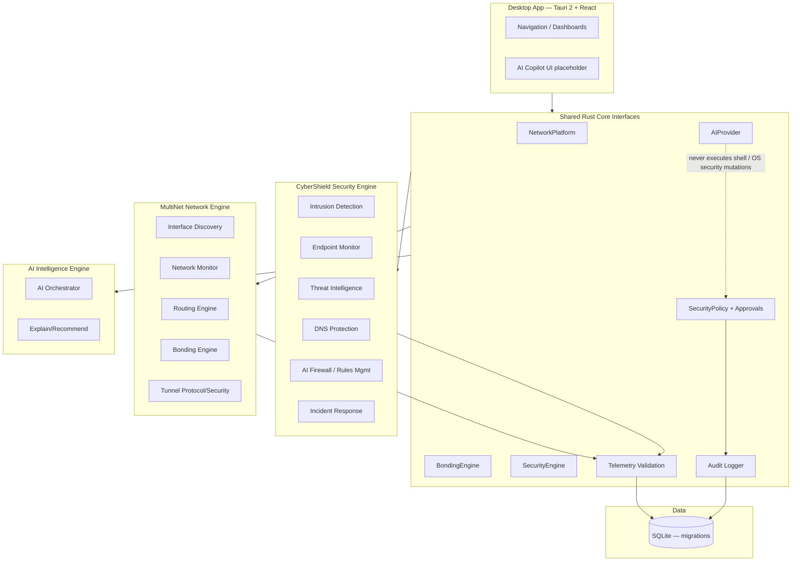

# System Architecture (Phase 1)

## Engines

## Phase 1 reality
- Traits compile as the contract; **mock/stub** implementations only in tests/foundation.
- No platform drivers, no packet capture, no IDS runtime, no route/firewall mutation, no cloud/relay execution.
