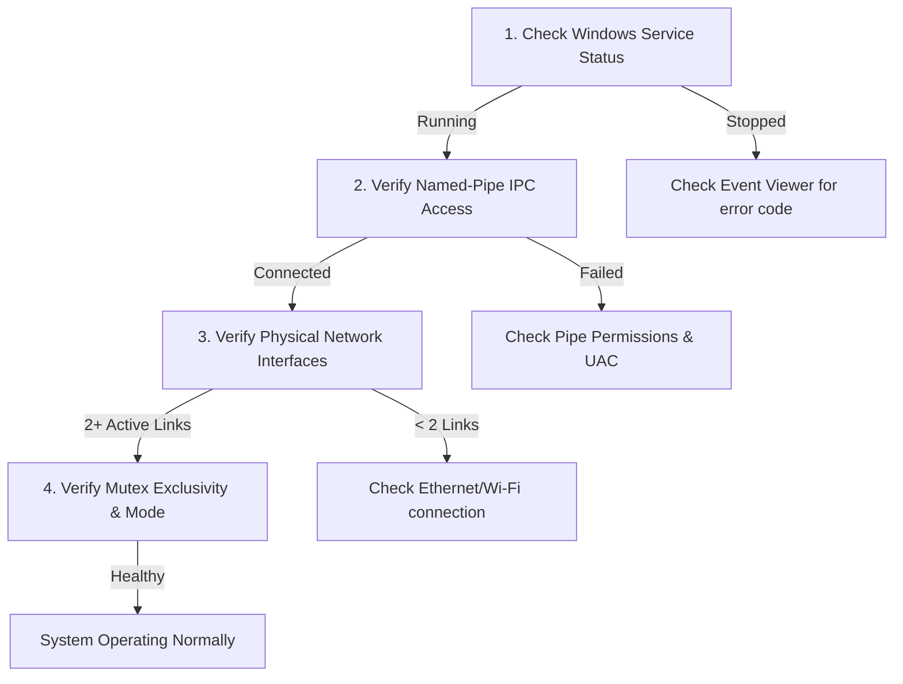

# MultiNet CyberShield AI — Beta Operator & Troubleshooting Guide
## Version 0.1.0-beta.1 (Milestone NM-07.0)

This guide documents diagnostic procedures, operational checklists, and remediation steps for issues encountered during the MultiNet CyberShield AI beta.

---

### 1. Operational Diagnostics Checklist

When diagnosing any unexpected behavior, verify the following core components in order:



#### Step 1: Query Service Control Manager
Open an elevated PowerShell prompt and run:
```powershell
Get-Service -Name "MultiNetNetMerge"
```
Or use the service's built-in CLI:
```powershell
& "C:\Program Files\MultiNet CyberShield AI\net-merge-service.exe" -action status
```
- **Healthy:** Status reports `Running`.
- **Faulted:** Status reports `Stopped` or `Not Installed`.

#### Step 2: Check Windows Event Log
Service events are recorded in the standard Windows Application log:
```powershell
Get-WinEvent -FilterHashtable @{LogName='Application'; ProviderName='MultiNetNetMerge'} -MaxEvents 15 | Format-Table TimeCreated, Id, Message -Wrap
```
- Event ID `1001` / `1002`: Service starting / started.
- Event ID `2001`: Mode transition (Mode A / Mode B).
- Event ID `2002`: Disaster recovery executed (route cleanup).
- Event ID `3001` / `3002`: Service error or security boundary violation.

#### Step 3: Inspect Named Pipe Endpoint
Verify that the protected named pipe is open and listening:
```powershell
[System.IO.Directory]::GetFiles("\\.\\pipe\\") -like "*multinet-netmerge*"
```
Expected output: `\\.\pipe\multinet-netmerge-ipc-v1`.

---

### 2. Common Symptoms & Remediation Steps

#### Symptom 1: Desktop UI displays "Service Disconnected"
- **Cause:** The `MultiNetNetMerge` background service is not running or the named pipe was closed.
- **Remediation:**
  1. Open an elevated PowerShell terminal.
  2. Start the service:
     ```powershell
     Start-Service -Name "MultiNetNetMerge"
     ```
  3. If the service fails to start, verify that another process is not holding the console lock:
     ```powershell
     & "C:\Program Files\MultiNet CyberShield AI\net-merge-service.exe" -console
     ```

#### Symptom 2: "Mode acquisition timed out / Mutex already owned"
- **Cause:** A previous bonding process crashed or an existing instance has not cleanly released the Windows kernel mutex `Global\multinet-netmerge-mode-owner-v1`.
- **Remediation:**
  1. MultiNet automatically cleans up abandoned mutexes after process crashes using OS-level thread tracking (`WAIT_ABANDONED`).
  2. If an orphaned test process is still running, check for any lingering `net-merge-service.exe` or bonding processes:
     ```powershell
     Get-Process -Name "net-merge-service", "multinet*" -ErrorAction SilentlyContinue
     ```
  3. Restart the service to trigger the automated state reset:
     ```powershell
     Restart-Service -Name "MultiNetNetMerge"
     ```

#### Symptom 3: Loss of internet connectivity after power failure or hard reset
- **Cause:** The system rebooted unexpectedly while Wintun capture routes (`0.0.0.0/1` and `128.0.0.0/1`) were active.
- **Remediation:**
  1. The `MultiNetNetMerge` service automatically runs `RunDisasterRecovery()` during startup to clear these routes.
  2. To manually verify or clear them in PowerShell (Elevated):
     ```powershell
     route delete 0.0.0.0 mask 128.0.0.0
     route delete 128.0.0.0 mask 128.0.0.0
     ```
  3. Verify physical default gateway routes:
     ```powershell
     Get-NetRoute -DestinationPrefix "0.0.0.0/0"
     ```

#### Symptom 4: Windows 11 Smart App Control (SAC) Warning
- **Cause:** Smart App Control blocks or warns on uncataloged pre-release beta binaries that do not carry an EV code-signing certificate trusted by the Microsoft cloud reputation database.
- **Remediation:**
  1. Ensure you are testing in a development or beta environment.
  2. If Windows Defender SmartScreen presents "Windows protected your PC", click **More info** -> **Run anyway**.
  3. In enterprise environments with centrally enforced SAC, whitelist the test directory or sign using a test certificate trusted in your enterprise certificate store.

#### Symptom 5: Wintun Virtual Adapter Driver Error
- **Cause:** `wintun.dll` missing from the application path or incompatible with system architecture.
- **Remediation:**
  1. Verify `wintun.dll` exists in `C:\Program Files\MultiNet CyberShield AI\drivers\wintun.dll`.
  2. Verify architecture is x64:
     ```powershell
     [System.Reflection.AssemblyName]::GetAssemblyName("C:\Program Files\MultiNet CyberShield AI\drivers\wintun.dll")
     ```
  3. If missing, run an MSI repair:
     ```powershell
     msiexec.exe /fa MultiNetCyberShield-Setup.msi /qn
     ```

---

### 3. Sanitized Diagnostic Bundle Generation

Before submitting an issue report, generate a sanitized diagnostic report:

```powershell
# Create sanitized diagnostics directory:
$diagDir = Join-Path $env:TEMP "MultiNet-Diag-$((Get-Date).ToString('yyyyMMdd-HHmmss'))"
New-Item -ItemType Directory -Force -Path $diagDir | Out-Null

# 1. Capture service status
& "C:\Program Files\MultiNet CyberShield AI\net-merge-service.exe" -action status > (Join-Path $diagDir "service-status.txt")

# 2. Capture sanitized network adapter summary (redacting MAC & external IPs)
Get-NetAdapter | Select-Object Name, InterfaceDescription, Status, LinkSpeed | Out-File (Join-Path $diagDir "adapters.txt")

# 3. Capture recent Application Event Log entries
Get-WinEvent -FilterHashtable @{LogName='Application'; ProviderName='MultiNetNetMerge'} -MaxEvents 30 | 
    Format-List TimeCreated, Id, LevelDisplayName, Message | 
    Out-File (Join-Path $diagDir "eventlog.txt")

# 4. Compress bundle
Compress-Archive -Path "$diagDir\*" -DestinationPath "$diagDir.zip"
Write-Host "Diagnostic bundle saved to: $diagDir.zip" -ForegroundColor Green
```
Attach `$diagDir.zip` to your GitHub issue report.
