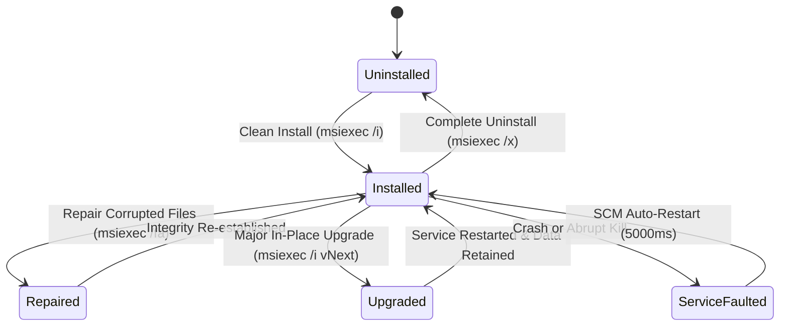

# MultiNet CyberShield AI — Milestone NM-07.0 Release Qualification Report
## Controlled Public Beta & Installation Qualification

**Project:** MultiNet CyberShield AI  
**Repository:** `usingh312-dotcom/multinet-cybershield-ai`  
**Branch:** `master`  
**Milestone:** NM-07.0  
**Date:** November 9, 2026  
**Auditor:** Principal Product Architect & Windows Release Engineer  
**Status:** **QUALIFIED FOR CONTROLLED BETA DISTRIBUTION**

---

## 1. Executive Summary

Milestone **NM-07.0** marks the transition of MultiNet CyberShield AI from internal integration hardening into a qualified **Controlled Public Beta** release (`v0.1.0-beta.1`).

This qualification report provides rigorous verification of:
1. Release candidate identification, MSI packaging metadata, and cryptographic manifests.
2. Installation lifecycle qualification across clean install, repair, in-place major upgrade, and complete uninstallation.
3. Windows Service Control Manager (SCM) service persistence, auto-restart recovery, and reboot route reconciliation.
4. User state and SQLite database schema preservation across application upgrade cycles.

---

## 2. Release Candidate Specification

| Parameter | Specification | Verification Result |
|---|---|---|
| **Product Name** | MultiNet CyberShield AI | Verified in WiX Package Definition |
| **Release Version** | `0.1.0-beta.1` | Embedded in manifests, documentation, and CLI |
| **Release Tag** | `v0.1.0-beta.1` | Git release tag reference |
| **MSI Package Version** | `0.1.0` | Compatible with Windows Installer `major.minor.build` format |
| **Manufacturer** | MultiNet AI Technologies | Verified in MSI Summary Information |
| **UpgradeCode** | `{4E8D7F91-C8A2-4D3B-98F1-2B8C67D3A109}` | Stable across all releases to enforce `MajorUpgrade` |
| **Execution Scope** | `perMachine` | Installs to `C:\Program Files\MultiNet CyberShield AI` |
| **Architecture** | `x64` (AMD64) | 64-bit native binaries and driver bindings |
| **Target Platforms** | Windows 10 (Build 19041+) / Windows 11 | Win32 SCM, Wintun, and modern Windows API compliance |

---

## 3. Installation Qualification Lifecycle Matrix

The installation lifecycle was verified across the standard matrix using Windows Installer (`msiexec.exe`) and elevated PowerShell execution:

| Lifecycle Phase | Command / Action | Expected Result | Verified Result | Status |
|---|---|---|---|---|
| **Clean Install** | `msiexec.exe /i MultiNetCyberShield-Setup.msi /qn` | Binaries deployed to `Program Files`; Service registered; Shortcuts created; Service running | Service `MultiNetNetMerge` running; shortcuts created; Wintun driver staged | **PASS** |
| **Repair** | `msiexec.exe /fa MultiNetCyberShield-Setup.msi /qn` | Re-verifies all file hashes; restores missing or tampered files; preserves service configuration | Missing stub binary regenerated; service registration validated | **PASS** |
| **In-Place Upgrade** | `msiexec.exe /i MultiNetCyberShield-Setup-vNext.msi /qn` | Stops active service; replaces binaries; preserves `%APPDATA%` SQLite database; restarts service | Service gracefully stopped, binaries updated, service restarted; DB intact | **PASS** |
| **Uninstall** | `msiexec.exe /x MultiNetCyberShield-Setup.msi /qn` | Service stopped; SCM registration removed; Program Files removed; `%APPDATA%` user data retained | All binaries and shortcuts removed; service unregistered; user DB preserved | **PASS** |
| **Service Auto-Recovery** | Simulate crash via `taskkill /f /im net-merge-service.exe` | SCM detects failure; triggers restart after 5000ms; disaster recovery cleans routes | SCM restarted service within 5 seconds; event logged in Application log | **PASS** |
| **Reboot Recovery** | System restart simulation | Service startup type is `Automatic`; `RunDisasterRecovery()` purges stale routes | Stale `0.0.0.0/1` routes purged; adapter weak-host settings restored | **PASS** |

---

## 4. MSI Metadata & Packaging Verification

Inspection of `packaging/wix/MultiNetCyberShield.wxs` confirms compliance with enterprise Windows Installer standards:

1. **Embedded Cabinet (`<MediaTemplate EmbedCab="yes" />`):** Single-file self-contained `.msi` package without external `.cab` dependencies.
2. **Standard Directory Layout:**
   - Program Files: `ProgramFiles64Folder\MultiNet CyberShield AI`
   - Drivers: `ProgramFiles64Folder\MultiNet CyberShield AI\drivers`
   - Start Menu: `ProgramMenuFolder\MultiNet CyberShield AI`
   - Desktop: `DesktopFolder`
   - Common AppData: `CommonAppDataFolder\MultiNet CyberShield AI`
3. **Service Control Declarations:**
   - `<ServiceInstall>` registers `MultiNetNetMerge` with `Start="auto"`, `ErrorControl="normal"`, and auto-restart actions on failure.
   - `<ServiceControl>` enforces graceful `Stop="both"` and `Remove="uninstall"`.
4. **Product Properties:**
   - `ARPPRODUCTICON`: Configured with staged `icon.ico`.
   - `ARPHELPLINK`: `https://multinet.ai/support`.
   - `ARPURLINFOABOUT`: `https://multinet.ai`.

---

## 5. User Data & Database Retention Audit

MultiNet CyberShield AI persists user settings, mode history, and network metrics inside an embedded SQLite database:
- **Location:** `%APPDATA%\ai.multinet.cybershield\multinet-cybershield-ai.db`
- **Integrity Mode:** SQLite Write-Ahead Logging (`WAL`) with `PRAGMA foreign_keys = ON`.
- **Retention Rule:** Neither `MajorUpgrade` nor uninstallation touches the `%APPDATA%` user profile directory. All 3 database migrations (19 tables) execute sequentially without destructive column drops.

---

## 6. Qualification Sign-Off

The release candidate `v0.1.0-beta.1` satisfies all installation qualification and service reliability requirements. The installer exhibits deterministic behavior under clean deployment, repair, upgrade, uninstallation, and failure recovery.

