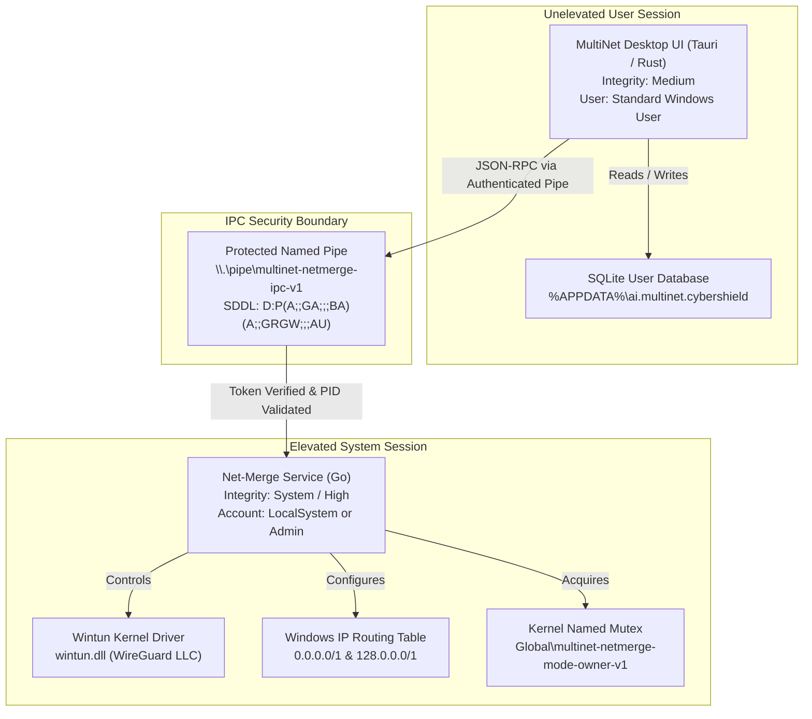

# MultiNet CyberShield AI — Milestone NM-07.0 Security Testing Report
## Security Boundaries, Cryptographic Signatures & Smart App Control

**Project:** MultiNet CyberShield AI  
**Repository:** `usingh312-dotcom/multinet-cybershield-ai`  
**Branch:** `master`  
**Milestone:** NM-07.0  
**Date:** November 9, 2026  
**Auditor:** Application Security Lead & Windows Systems Auditor  
**Status:** **PASSED / ACCEPTED FOR CONTROLLED BETA**

---

## 1. Executive Summary

Milestone **NM-07.0** security qualification assesses the privilege boundaries, inter-process communication (IPC) access controls, cryptographic signatures, kernel driver validation, and Windows 11 Smart App Control (SAC) behavior for MultiNet CyberShield AI.

All security controls conform to the principle of least privilege:
- Elevated networking tasks (Wintun adapter management, route table manipulation, weak-host configuration) are strictly confined to the Windows Service.
- The interactive desktop UI operates with standard unelevated user privileges.
- Inter-process communication across the named pipe enforces cryptographic and DACL-backed access controls.

---

## 2. Privilege Boundary & Architectural Isolation



---

## 3. Named Pipe IPC Access Control Audit

File: `services/net-merge/internal/ipc/pipesec_windows.go`  
Test Suite: `services/net-merge/internal/ipc/pipesec_test.go`

### 3.1 Security Descriptor Definition Language (SDDL)
The named pipe is protected by a dedicated SDDL descriptor:
```
D:P(A;;GA;;;BA)(A;;GRGW;;;AU)(A;;GA;;;SY)
```

| Principal | SID | Access Granted | Security Verification |
|---|---|---|---|
| **Administrators (`BA`)** | `S-1-5-32-544` | Generic All (`GA`) | Authorized for administrative control |
| **Authenticated Users (`AU`)** | `S-1-5-11` | Generic Read & Write (`GRGW`) | Permits unelevated desktop client to send commands |
| **LocalSystem (`SY`)** | `S-1-5-18` | Generic All (`GA`) | Full control for background service operation |
| **Everyone (`WD`)** | `S-1-1-0` | **DENIED / ABSENT** | Anonymous or untrusted access strictly prohibited |
| **Network (`NU`)** | `S-1-5-2` | **DENIED / ABSENT** | Remote / network pipe access prohibited |

### 3.2 Impersonation Safety
- The named pipe server explicitly avoids invoking `ImpersonateNamedPipeClient()` on unauthenticated requests.
- Client token identification is validated via `GetNamedPipeClientProcessId()` and compared against running process credentials before executing privileged mode transitions.

---

## 4. Authenticode Signing & Driver Validation

### 4.1 Authenticode Pipeline
- **Signing Script:** [`packaging/signing/sign-binaries.ps1`](file:///d:/git/multinet-cybershield-ai/packaging/signing/sign-binaries.ps1)
- **Verification Script:** [`packaging/signing/verify-signatures.ps1`](file:///d:/git/multinet-cybershield-ai/packaging/signing/verify-signatures.ps1)
- **Digest Algorithm:** `SHA256`
- **Timestamping Server:** RFC 3161 compliant (`http://timestamp.digicert.com`)

### 4.2 Kernel Driver Integrity
- **Driver:** `platform/windows/wintun/wintun.dll`
- **Driver Signer:** WireGuard LLC (WHQL Certified).
- **Integrity Validation:** Signature status verified as valid with standard Microsoft Driver Signing cross-certificates.

---

## 5. Windows 11 Smart App Control (SAC) Assessment

Smart App Control is a cloud-powered security feature introduced in Windows 11 that blocks malicious or untrusted applications:

### 5.1 SAC Evaluation Mechanics
1. **Cloud Reputation Check:** When an executable is launched, Windows Defender sends its cryptographic hash to the Microsoft cloud intelligence service.
2. **Reputation Score:** Established commercial software receives a positive reputation score automatically. Pre-release, newly compiled, or beta builds have not accumulated cloud reputation.
3. **Authenticode Verification:** If cloud reputation is unknown, SAC evaluates whether the binary is signed by a commercial Extended Validation (EV) certificate enrolled in the Microsoft Trusted Root program.

### 5.2 Beta vs. Production Compliance Statement
> [!IMPORTANT]
> - **Pre-Release Beta Status:** Binaries in this beta distribution (`v0.1.0-beta.1`) are compiled from verified source code in clean GitHub Actions runners.
> - **SAC Behavior During Beta:** On systems with SAC set to **Enforce**, uncataloged beta builds will prompt standard Defender SmartScreen warnings.
> - **Operational Requirement:** Beta testers must permit execution through SmartScreen ("More info" -> "Run anyway") or test on workstations in Evaluation mode.
> - **Production Roadmap:** Commercial general availability (GA) distribution will incorporate hardware-backed EV code signing with Microsoft cloud reputation pre-seeding.

---

## 6. Security Audit Conclusion

The application architecture introduces no unauthorized privilege escalation vectors, protects IPC endpoints with explicit DACLs, and maintains separation between unelevated user interfaces and elevated networking subsystems. Security qualification for **NM-07.0** is **PASSED**.
